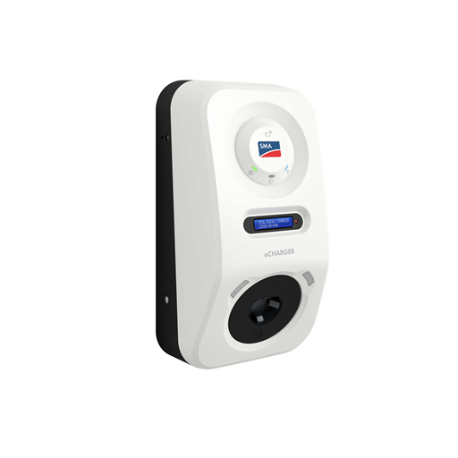

# ioBroker.sma-echarger

**Tests:** 

## SMA eCharger adapter for ioBroker

This adapter connects your **SMA eCharger** (e.g., EVC22-3AC-20) locally via its HTTPS JSON API to ioBroker. It allows you to monitor live charging values, read device parameters, and control charging modes or power limits.

### Features
* **Live Measurements (`Live.*`):** Current charging power (W), total and session energy (Wh), charging status, device health, phase currents (L1–L3), and voltages.
* **Device Parameters (`Parameter.*`):** Automatic retrieval of all readable SMA eCharger configuration parameters.
* **Remote Control (`Control.*`):** Change the charging mode (Fast, PV Surplus, Target, Stop), adjust maximum active power (`WMax` / `WMaxIn`), and control charging release.

### Configuration
1. Open the adapter instance settings in ioBroker.
2. Enter the local **IP address** of your SMA eCharger.
3. Enter your **Username** (`user` for reading values, or `admin` / an installer account if you want to modify inverter power limits like `WMax`) and **Password**.
4. Set the desired **Poll interval** in seconds (default: `15` seconds).

---

## Deutsche Beschreibung

Dieser Adapter bindet deinen **SMA eCharger** (z. B. EVC22-3AC-20) lokal über die HTTPS-JSON-Schnittstelle an ioBroker an. Damit lassen sich Live-Messwerte auslesen, Geräteparameter überwachen sowie Lademodus und Leistungsbegrenzungen direkt steuern.

### Funktionen
* **Live-Messwerte (`Live.*`):** Aktuelle Ladeleistung (W), Gesamt- und Sitzungsenergie (Wh), Fahrzeug-/Ladestatus, Gerätestatus sowie Phasenströme (L1–L3) und Spannungen.
* **Geräteparameter (`Parameter.*`):** Automatisches Auslesen der Konfigurationsparameter des SMA eChargers.
* **Steuerung (`Control.*`):** Umschalten des Lademodus (Schnellladen, PV-Überschuss, Zielvorgabe, Stopp), Setzen der maximalen Wirkleistung (`WMax` / `WMaxIn`) und Ladefreigabe.

### Konfiguration
1. Öffne die Instanz-Einstellungen des Adapters im ioBroker Admin-Panel.
2. Trage die lokale **IP-Adresse** deines SMA eChargers ein.
3. Hinterlege **Benutzername** (`user` zum reinen Auslesen, oder `admin` bzw. ein Installateur-Konto, wenn Leistungsparameter wie `WMax` geschrieben werden sollen) und **Passwort**.
4. Lege das gewünschte **Abfrageintervall** in Sekunden fest (Standard: `15` Sekunden).

### Disclaimer
*SMA* and *eCharger* are registered trademarks of SMA Solar Technology AG. This project is an independent open-source adapter and is not affiliated with or endorsed by SMA Solar Technology AG.

## Changelog
<!--
    Placeholder for the next version (at the beginning of the line):
    ### **WORK IN PROGRESS**
-->
### **WORK IN PROGRESS**
* (SpongeTroN86) Updated README documentation and fixed repository metadata in io-package.json

### 0.1.7 (2026-11-18)

* SpongeTroN86 fix: removed windows-latest from test-and-release.yml

### 0.1.6 (2026-11-18)

* SpongeTroN86 fix: removed macos-latest from test-and-release.yml

### 0.1.5 (2026-11-18)

* SpongeTroN86 fix: add npm environment variables for deployment

### 0.1.4 (2026-11-18)

* SpongeTroN86 fix: add "WORK IN PROGRESS" section to README

### 0.1.3 (2026-11-18)

* SpongeTroN86 fix: add "WORK IN PROGRESS" section to README

### 0.1.2 (2026-11-18)

* (SpongeTroN86) Added trusted publishing workflow and updated adapter dependencies

### 0.1.1 (2026-11-18)

* (SpongeTroN) initial release

## License

MIT License

Copyright (c) 2026 SpongeTroN <rolf@bunter-waeschekorb.de>

Permission is hereby granted, free of charge, to any person obtaining a copy
of this software and associated documentation files (the "Software"), to deal
in the Software without restriction, including without limitation the rights
to use, copy, modify, merge, publish, distribute, sublicense, and/or sell
copies of the Software, and to permit persons to whom the Software is
furnished to do so, subject to the following conditions:

The above copyright notice and this permission notice shall be included in all
copies or substantial portions of the Software.

THE SOFTWARE IS PROVIDED "AS IS", WITHOUT WARRANTY OF ANY KIND, EXPRESS OR
IMPLIED, INCLUDING BUT NOT LIMITED TO THE WARRANTIES OF MERCHANTABILITY,
FITNESS FOR A PARTICULAR PURPOSE AND NONINFRINGEMENT. IN NO EVENT SHALL THE
AUTHORS OR COPYRIGHT HOLDERS BE LIABLE FOR ANY CLAIM, DAMAGES OR OTHER
LIABILITY, WHETHER IN AN ACTION OF CONTRACT, TORT OR OTHERWISE, ARISING FROM,
OUT OF OR IN CONNECTION WITH THE SOFTWARE OR THE USE OR OTHER DEALINGS IN THE
SOFTWARE.
