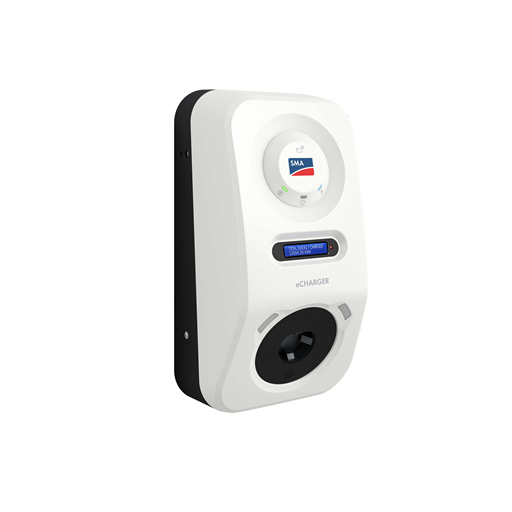

# ioBroker.sma-echarger

[English documentation](../../README.md)

## SMA eCharger Adapter für ioBroker

Dieser Adapter bindet deinen **SMA eCharger** (z. B. EVC22-3AC-20) lokal über die HTTPS-JSON-Schnittstelle an ioBroker an. Damit lassen sich Live-Messwerte auslesen, Geräteparameter überwachen sowie Lademodus und Leistungsbegrenzungen direkt steuern.

### Funktionen

* **Live-Messwerte (`Live.*`):** Aktuelle Ladeleistung (W), Gesamt- und Sitzungsenergie (Wh), Fahrzeug-/Ladestatus, Gerätestatus sowie Phasenströme (L1–L3) und Spannungen.
* **Geräteparameter (`Parameter.*`):** Automatisches Auslesen der Konfigurationsparameter des SMA eChargers.
* **Steuerung (`Control.*`):** Umschalten des Lademodus (Schnellladen, PV-Überschuss, Zielvorgabe, Stopp), Setzen der maximalen Wirkleistung (`WMax` / `WMaxIn`) und Ladefreigabe.

### Konfiguration

1. Öffne die Instanz-Einstellungen des Adapters im ioBroker Admin-Panel.
2. Trage die lokale **IP-Adresse** deines SMA eChargers ein.
3. Hinterlege **Benutzername** (`user` zum reinen Auslesen, oder `admin` bzw. ein Installateur-Konto, wenn Leistungsparameter wie `WMax` geschrieben werden sollen) und **Passwort**.
4. Lege das gewünschte **Abfrageintervall** in Sekunden fest (Standard: `15` Sekunden).

### Haftungsausschluss

*SMA* und *eCharger* sind eingetragene Marken der SMA Solar Technology AG. Dieses Projekt ist ein unabhängiger Open-Source-Adapter und steht in keiner Verbindung zur SMA Solar Technology AG.
